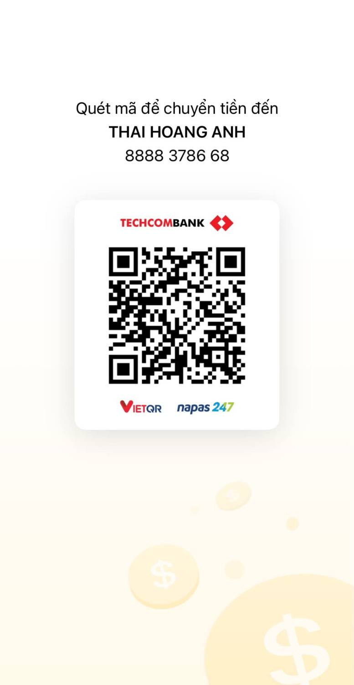

# Tích Đức — Gõ mõ online & Chính điện 3D

Web gõ mõ tích công đức, xem lịch âm, rút quẻ, cùng chính điện 3D nhiều người để dâng hương, tụng kinh. Có cửa hàng (SePay) và bộ phát TikTok LIVE.

- Trang chính: `index.html`. Chính điện 3D: `chua.html`.
- Chạy được trên **VPS** (`server/`, đầy đủ tính năng) hoặc **Vercel** (`api/`, chính điện chơi một mình).
- Không cần đăng ký: tiến trình lưu trên trình duyệt, kèm **mã khôi phục** để dùng trên máy khác.

---

## Hướng dẫn cho người dùng

### Gõ mõ (tab 🪘)

- **Chạm vào mõ** hoặc nhấn **Space** để gõ. Mỗi nhịp cộng công đức theo hệ số của cảnh giới hiện tại.
- Vòng tròn quanh mõ là tiến độ lên cảnh giới kế tiếp. Có 9 cảnh giới, từ Sơ tâm (x1) đến Giác tỉnh (x256).
- Gõ nhanh bất thường (quá 15 nhịp/giây) sẽ không được tính.
- Nút nhanh dưới mõ:
  - **🔔 Thỉnh chuông**: nghe tiếng chuông, mỗi 4 giây được thỉnh một lần.
  - **📤 Khoe**: tạo ảnh công đức để chia sẻ.
  - **🙏 Hồi hướng**: đọc bài hồi hướng, có thể ghi tên người được hồi hướng.
  - **🪘 Đổi mõ**: chọn loại mõ (mỗi loại có tiếng gõ riêng) và mở cửa hàng.
- Trên thanh đầu trang:
  - **🎶**: bật/tắt nhạc thiền kèm tiếng suối.
  - **🔊**: bật/tắt âm thanh gõ.
  - Nhãn ngày âm (VD `22/9 Âm`): bấm để sang tab Lịch.
- Thẻ **🛕 Vào chính điện 3D** dẫn sang chính điện.

### Lịch (tab 🌙)

Ngày âm, can chi ngày/tháng/năm, ngày hoàng đạo hay hắc đạo, trực thần và các giờ hoàng đạo. Nút **Lời hay hôm nay** mở câu ca dao, tục ngữ của ngày.

### Quẻ (tab 🎴)

Mỗi ngày rút một quẻ. Quẻ chỉ để tham khảo.

### Bảng xếp hạng (tab 🏆)

- Ba bảng: **Hôm nay** (theo số nhịp), **Tất cả** (theo công đức) và **Tỉnh thành** (cộng dồn theo 34 tỉnh, thành).
- Ô trên cùng cho biết hạng của bạn; chạm vào để đặt pháp danh và chọn tỉnh.
- 👑 là Hội viên.

### Hành trình (tab 📿)

- Số lần gõ, thời gian tu tập, chuỗi ngày tinh tấn và 9 cảnh giới.
- **Hồ sơ**: đặt pháp danh, chọn tỉnh thành, xem **mã khôi phục** 8 ký tự.
- Để dùng tiến trình trên máy khác: nhập mã khôi phục vào ô **Khôi phục**.

### Cửa hàng (nút 🪘 Đổi mõ)

- Mõ chưa mở có viền vàng và giá; chạm vào để mua. Gói **👑 Hội viên** (1 tháng / 1 năm) mở mọi loại mõ và thêm huy hiệu trên bảng xếp hạng.
- Thanh toán bằng chuyển khoản VietQR: quét mã bằng app ngân hàng, số tiền và nội dung đã điền sẵn. Khoảng vài giây sau khi chuyển, vật phẩm tự mở khoá.
- **Phải giữ đúng nội dung chuyển khoản** (mã `TD…`) để hệ thống nhận ra đơn.
- Vật phẩm chỉ để trang trí: không cộng công đức và không hoàn tiền.

### Chính điện 3D (`chua.html`)

**Tạo nhân vật**: đặt pháp danh (🎲 để gợi ý tên), chọn giới tính, kiểu tóc, màu da và áo, rồi bấm **Vào chính điện**.

**Điều khiển**

| Thao tác | Kết quả |
|---|---|
| **W A S D** hoặc **phím mũi tên** | Đi lại theo hướng camera |
| **Click / chạm lên sàn** | Đi tới điểm đó |
| **Kéo chuột / vuốt** | Xoay góc nhìn quanh nhân vật |

**Dâng hương** (nút 🪔):
1. Đến đệm quỳ.
2. Chọn 1, 3 hoặc 5 nén.
3. Thắp hương.
4. Vái 3 vái.
5. Cắm vào bát hương.
6. Gửi lời nguyện. Lời nguyện chỉ hiện trên máy bạn, không lưu lại.

**Tụng kinh** (nút 📿):
- Quỳ ở đệm. Mõ tự gõ theo nhịp, chuông ngân mỗi 50 giây.
- Bấm **Niệm** để niệm từng câu kinh; câu kinh nổi trên đầu nhân vật cho mọi người cùng thấy.

**Dâng lễ** (thanh bên trái):

| Lễ vật | Điểm | Thời gian chờ |
|---|---|---|
| 🌸 Hoa | +1 | 3 giây |
| 🪔 Hương | +3 | 8 giây |
| 🪷 Sen | +9 | 20 giây |
| 🔔 Chuông | +27 | 45 giây |

Điểm cộng vào **Bảng Công Đức** của phòng.

**Khác**
- **Biểu cảm** (thanh bên phải): 🙏 🪷 ❤️ ☸️ bay trên đầu nhân vật.
- **🗣️**: bật/tắt giọng đọc tiếng Việt (chào người mới vào, xướng tên hồi hướng). Microsoft Edge có giọng đọc tự nhiên nhất.
- **Nhiều người** (chỉ bản VPS): mỗi phòng 20 chỗ, thấy nhau đi lại, quỳ, dâng hương, tụng kinh.

---

## Chạy trên máy

Cần Node.js 22.

```bash
node server/index.js
```

Mở `http://localhost:5173`. Máy chủ không cần cài thêm gói. Dữ liệu lưu ở `server/data.json`.

**Thử cửa hàng không cần tiền thật**: chạy với `PAYMENT_TEST=1`, màn thanh toán sẽ có nút "🧪 Giả lập đã chuyển khoản".

```bash
PAYMENT_TEST=1 node server/index.js
```

**Kiểm thử API bản Vercel** (Redis giả lập trong bộ nhớ):

```bash
npm run test:api
```

## Triển khai

| Nơi | Hướng dẫn | Ghi chú |
|---|---|---|
| VPS (Ubuntu + Caddy) | [DEPLOY.md](DEPLOY.md) | Đầy đủ tính năng, kể cả chính điện nhiều người |
| Vercel + Upstash Redis | [VERCEL.md](VERCEL.md) | Chính điện chơi một mình; có thu tiền thì cần gói Pro |

**Biến môi trường**

| Biến | Dùng cho |
|---|---|
| `PORT`, `HOST`, `TRUST_PROXY` | Máy chủ VPS (sau Caddy: `HOST=127.0.0.1`, `TRUST_PROXY=1`) |
| `SEPAY_API_KEY`, `BANK_NAME`, `BANK_ACCOUNT`, `ACCOUNT_NAME` | Cửa hàng SePay |
| `PAYMENT_TEST=1` | Nút giả lập thanh toán — **chỉ dùng khi phát triển**, không bật trên máy chủ thật |
| `UPSTASH_REDIS_REST_URL/TOKEN` hoặc `KV_REST_API_URL/TOKEN` | Redis trên Vercel (Vercel tự đặt khi kết nối Upstash) |

Giá sản phẩm và luật cảnh giới nằm ở `api/_lib/rules.js`, dùng chung cho cả VPS và Vercel.

## Bộ phát TikTok LIVE

Chạy trên máy phát, đưa chính điện 3D lên TikTok LIVE dạng 9:16:
- Người xem bình luận thì vào quỳ trong chính điện.
- Tặng quà thì được xướng tên hồi hướng.
- Thả tim thì ❤️ bay trên đầu nhân vật.

```bash
cd live && npm install && npm start
```

Mở `http://localhost:3000`. Chi tiết xem [live/README.md](live/README.md).

## Cấu trúc thư mục

```
index.html, styles.css, game.js   Trang gõ mõ (lịch âm, quẻ, BXH, cửa hàng)
chua.html, chua.js, avatar.js     Chính điện 3D (Three.js) + nhân vật
sw.js, manifest.json, icon.svg    Cài như app, chạy khi mất mạng
server/index.js                   Máy chủ VPS: file tĩnh + API + phòng nhiều người
api/index.js, api/_lib/           API cho Vercel (Upstash Redis) + luật dùng chung
live/                             Bộ phát TikTok LIVE (chỉ chạy localhost)
scripts/test-api.js               Kiểm thử API Vercel
```

Mỗi lần cập nhật giao diện, nhớ tăng `VERSION` trong `sw.js` để máy người dùng tải bản mới.

## ☕ Ủng hộ tác giả

Nếu thấy dự án hữu ích, xin ủng hộ tác giả một ly cà phê để có thêm động lực duy trì và làm thêm tính năng. Xin cảm ơn và chúc bạn thân tâm an lạc 🙏

| | |
|---|---|
| Ngân hàng | **Techcombank** |
| Số tài khoản | **8888 3786 68** |
| Chủ tài khoản | **THAI HOANG ANH** |



## Ghi công & lưu ý

- Thư viện 3D: [Three.js](https://threejs.org) (MIT), tải từ jsDelivr.
- `tiktok-live-connector` là thư viện cộng đồng, không phải API chính thức của TikTok.
- Ảnh nền chính điện `bg-chinh-dien.png` do chủ dự án cung cấp; hãy bảo đảm bạn có quyền sử dụng trước khi đưa lên mạng.
- Thu tiền bán vật phẩm hay nhận quà livestream là hoạt động có thu nhập: cần tuân thủ quy định về kinh doanh, thuế và hoạt động tôn giáo nơi bạn sinh sống.
